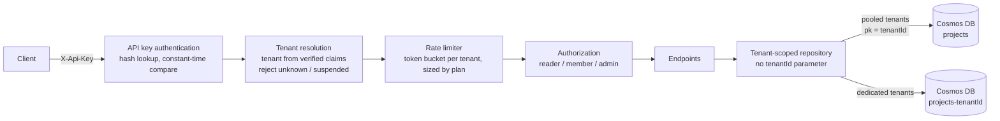

# Multi-Tenant SaaS API on ASP.NET Core 8 — Isolation, Plans, Noisy-Neighbour Protection

[](https://github.com/nitanandsinghupw/aspnetcore-multitenant-saas-api/actions/workflows/ci.yml)


A reference implementation of the parts of a multi-tenant SaaS backend that are easy to get wrong:
**keeping tenants' data apart**, **enforcing plan limits**, **stopping one busy tenant from slowing down
everyone else**, and offering **dedicated storage** for tenants who need it. Built on ASP.NET Core minimal
APIs with a Cosmos DB adapter and managed-identity infrastructure.

## What it shows

**Tenant isolation by construction.** The tenant comes from the verified credential, never from a header,
URL or request body. Data access goes through a repository that has no `tenantId` parameter at all, so a
forgotten filter can't leak data. Asking for another tenant's project id returns `404`, not `403`, so the
API doesn't even confirm it exists.

**Plans with real limits.** Free, Pro and Enterprise tiers get different rate limits and project quotas.

**Noisy-neighbour protection.** Each tenant has its own token-bucket rate limit sized by its plan. From the
included demo, where Acme (Free) floods the API with 20 parallel clients while Globex (Pro) makes normal
requests:

| Rate limiting | Acme requests | Acme throttled | Globex requests | Globex succeeded |
|---|---:|---:|---:|---:|
| One shared limit | 40,762 | 40,612 | 38 | **2 (5%)** |
| Per-tenant limits | 31,160 | 31,147 | 39 | **39 (100%)** |

With a shared limit, Acme's flood takes Globex down too. With per-tenant limits only Acme is throttled.

```bash
dotnet run --project samples/NoisyNeighborDemo
```

**Pooled and dedicated isolation.** Most tenants share one container, separated by partition key.
Enterprise tenants can get their own container with their own throughput, which also makes per-tenant
export, restore and deletion simple.

## Architecture



## Design decisions

**1. The tenant is part of the identity, not the request.**
[`TenantResolutionMiddleware`](src/SaasApi/Tenancy/TenantResolutionMiddleware.cs) reads the tenant id from
the authenticated claims, loads the tenant, rejects unknown or suspended ones, and adds `TenantId` to the
log scope for every line of that request. Once set, the tenant for a request can't be changed.

**2. Data access that can't be used wrongly.**
[`TenantScopedProjectRepository`](src/SaasApi/Data/TenantScopedProjectRepository.cs) takes the tenant from
the request context. The storage layer requires the tenant id as the partition key on every call, which in
Cosmos DB means a query physically cannot read another tenant's items, and every query stays a cheap
single-partition query.

**3. API keys stored like passwords.**
Keys look like `sk_{keyId}_{secret}`. Only a SHA-256 hash of the secret is stored, the key id finds the
record, and the comparison is constant-time. Every failure returns the same message. See
[`ApiKeys.cs`](src/SaasApi/Security/ApiKeys.cs).

**4. Rate limiting after tenant resolution.**
The limiter runs after the tenant is known, so it can partition by tenant and size each bucket by plan.
Rejected requests get `429` with a `Retry-After` header.

**5. Pooled by default, dedicated when it's worth it.**
[`ContainerResolver`](src/SaasApi/Data/ContainerResolver.cs) picks the container from the tenant's isolation
mode. Dedicated containers are created during tenant onboarding by infrastructure, because the app's
identity only has data-plane access.

**6. No keys to leak in Azure.**
The Bicep template disables Cosmos DB account keys entirely and gives the App Service's managed identity
the built-in data-contributor role on that one account.

## Project layout

```
src/SaasApi                ASP.NET Core API: tenancy, API key auth, rate limiting, tenant-scoped data access.
src/SaasApi.Cosmos         Cosmos DB store (partition key = tenantId) with managed identity.
samples/NoisyNeighborDemo  Starts the API in-process and compares shared vs per-tenant rate limits.
tests/SaasApi.Tests        xUnit tests for isolation, quotas, tenant context and API keys.
infra/main.bicep           Cosmos DB (keys disabled), pooled + dedicated containers, App Service, RBAC.
```

## Run it

Requires the [.NET 8 SDK](https://dotnet.microsoft.com/download/dotnet/8.0).

```bash
dotnet build
dotnet test
dotnet run --project src/SaasApi        # http://localhost:5080, Development seed data
```

Then use [`src/SaasApi/SaasApi.http`](src/SaasApi/SaasApi.http), or curl:

```bash
curl -H "X-Api-Key: sk_acme01_dev-acme-admin-000000000001" http://localhost:5080/me
```

Development tenants and keys (loaded only when `Seed:UseDevData` is true; the app refuses to start with it
enabled in Production):

| Tenant | Plan | Isolation | Key | Role |
|---|---|---|---|---|
| acme | Free | Pooled | `sk_acme01_dev-acme-admin-000000000001` | admin |
| acme | Free | Pooled | `sk_acme02_dev-acme-reader-00000000002` | reader |
| globex | Pro | Pooled | `sk_globex1_dev-globex-member-0000003` | member |
| initech | Enterprise | Dedicated | `sk_initech1_dev-initech-admin-000004` | admin |
| umbrella | Pro (suspended) | Pooled | `sk_umbrella1_dev-umbrella-admin-0005` | admin |

| Method | Route | Who | Result |
|---|---|---|---|
| GET | `/me` | any role | Tenant, plan, limits and caller |
| GET | `/projects` | any role | The caller's tenant's projects |
| GET | `/projects/{id}` | any role | `404` for another tenant's id |
| POST | `/projects` | member, admin | `201`, or `403` when the plan limit is reached |
| DELETE | `/projects/{id}` | admin | `204` or `404` |

## Using Cosmos DB

Deploy `infra/main.bicep`, reference `SaasApi.Cosmos` from your host, and register the store before the app
is built:

```csharp
SaasApiApp.Create(new WebApplicationOptions { Args = args }, builder =>
{
    builder.Services.AddCosmosProjectStore(
        builder.Configuration["Cosmos:AccountEndpoint"]!,
        builder.Configuration["Cosmos:Database"] ?? "saas");
}).Run();
```

## Adding user sign-in with Microsoft Entra ID

API keys suit machine-to-machine access. For users, add JWT bearer authentication
(`Microsoft.AspNetCore.Authentication.JwtBearer`) as a second scheme and map the token's tenant to the same
claim, for example with an `OnTokenValidated` event that looks up your tenant by the Entra `tid` claim and
adds `tenant_id`. Everything after authentication (tenant resolution, rate limits, data isolation) works
unchanged.

## Production checklist

This is a reference implementation. Before running it for real:

- Replace the in-memory tenant catalog and key store with a database, and add key rotation and revocation.
- Make plan quotas strict with a per-tenant counter document updated with an ETag check (see the comment
  in `TenantScopedProjectRepository.CreateAsync`).
- Run the rate limiter in a distributed store (or at the gateway, e.g. Azure API Management) when you run
  more than one instance.
- Add a tenant offboarding job that exports and deletes a tenant's partition or container.
- Emit per-tenant metrics (requests, 429s, RU usage) so you can see who's costing what.

## License

[MIT](LICENSE)
